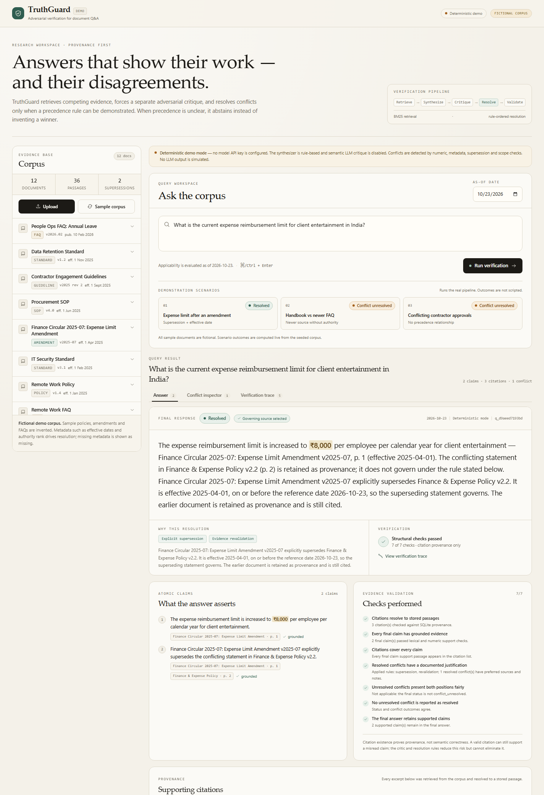
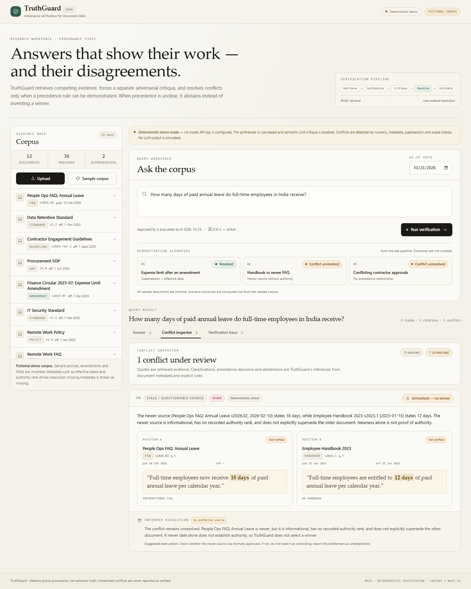
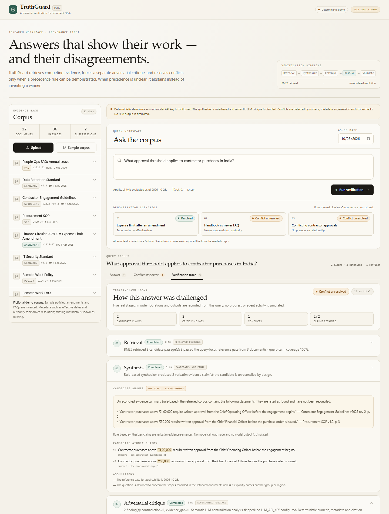
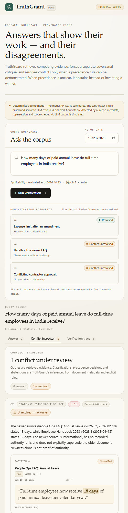

# TruthGuard

**Adversarial verification for multi-agent document Q&A.**

TruthGuard answers questions over a document corpus, then actively tries to break its own
answer. It retrieves competing passages, synthesizes a cited candidate, runs a separate critic
against contradictions and unsupported claims, and resolves conflicts only when a documented
precedence rule applies. When precedence is unclear, it abstains and shows both positions.

The demo is deliberately honest: **citations prove provenance, not semantic truth**, and an
unresolved conflict is never presented as a verified answer.



---

## What is implemented

- **Document ingestion** — PDF, TXT and Markdown upload with title, type, version, publication
  date, effective date, scope, authority metadata and explicit supersession relationships.
  PDF pages and page numbers are preserved. A built-in upload dialog collects metadata.
- **SQLite corpus** — documents and passages stored locally, with no external services.
- **BM25 retrieval** — lexical retrieval with per-document caps so one verbose source cannot
  crowd out competing evidence. A query-focus relevance gate removes incidental keyword matches
  before synthesis and critique.
- **Separate synthesizer** — rule-based evidence-only synthesizer by default; optional
  OpenAI-compatible LLM synthesizer with strict Pydantic validation. It deliberately returns an
  unreconciled candidate and atomic claims with passage citations.
- **Separate critic** — deterministic numeric/metadata checks for contradictions, staleness,
  supersession, scope mismatch, unsupported claims and evidence gaps. Optional LLM semantic
  critique is labelled **model-observed** and is never automatically accepted.
- **Rule-ordered resolver** — scope → explicit supersession → documented authority → effective
  dates → revalidation → abstain. It never chooses based on model confidence.
- **Evidence verifier** — resolves every citation to a stored passage, checks document/page
  metadata, checks lexical/numeric grounding, validates resolution justifications, and ensures
  unresolved conflicts are balanced and not reported as resolved.
- **Polished workspace** — query composer with as-of date, three seeded demonstration scenarios,
  corpus inspector, answer panel, side-by-side conflict inspector, and a five-stage verification
  trace with the actual candidate answer and critic findings.
- **Fictional sample corpus** — 12 documents with seeded contradictions, versions, amendments,
  stale FAQs, scope differences and missing precedence metadata.
- **Tests and evaluation** — 43 backend tests and a live three-scenario evaluation script.

---

## Quick start

### Prerequisites

- Python **3.11+** (tested on 3.13)
- Node.js **20+** and npm (tested on Node 22 / npm 10)
- No API key is required.

### 1. Backend

From the repository root:

```bash
python -m venv .venv
# Windows Git Bash:
source .venv/Scripts/activate
# macOS / Linux:
# source .venv/bin/activate

pip install -r backend/requirements.txt
cp .env.example .env        # optional; no secrets are needed for demo mode
python -m uvicorn app.main:app --app-dir backend --host 127.0.0.1 --port 8000
```

Verify: <http://127.0.0.1:8000/api/health> and <http://127.0.0.1:8000/docs>.

### 2. Frontend

In a second terminal:

```bash
cd frontend
npm install
npm run dev
```

Open <http://localhost:3000>. On the first visit, if the corpus is empty, the fictional sample
corpus is loaded automatically. The **Sample corpus** button reloads it idempotently while
preserving uploads.

### Production build

```bash
# Backend
python -m uvicorn app.main:app --app-dir backend --host 127.0.0.1 --port 8000

# Frontend
npm --prefix frontend run build
npm --prefix frontend run start
```

The Next.js app proxies `/backend/*` to `http://127.0.0.1:8000` by default. Set `BACKEND_URL` in
`frontend/.env.local` (or the shell) if the API runs elsewhere. See
[frontend/.env.example](frontend/.env.example).

Root helper scripts are available: `npm run backend`, `npm run dev`, `npm run build`,
`npm test`, and `npm run eval`.

---

## Demo walkthrough

1. Open the workspace. The corpus panel shows **12 fictional documents**, **36 passages** and
   **2 supersession links**.
2. Click **Expense limit after an amendment**.
   Expected: **Resolved**, selects **₹8,000** from Finance Circular 2025-07, and cites both the
   amendment and the ₹5,000 policy it supersedes.
3. Open **Conflict inspector** to see the two statements side by side, the declared supersession
   relationship, and the inferred resolution clearly separated from the retrieved quotes.
4. Open **Verification trace**. The synthesis stage shows the unreconciled candidate containing
   both ₹8,000 and ₹5,000; the critic reports the supersession; resolution applies the rule.
5. Click **Handbook vs newer FAQ**.
   Expected: **Conflict unresolved**. The handbook says 12 days, the 2026 FAQ says 18 days.
   The FAQ is newer but informational, has no authority rank, and does not amend the handbook.
   TruthGuard reports uncertainty rather than picking the newer source.
6. Click **Conflicting contractor approvals**.
   Expected: **Conflict unresolved**. The SOP requires CFO approval above ₹50,000; the
   contractor guidelines require COO approval above ₹1,00,000. Neither supersedes the other and
   the authority ranks differ by less than the decisive threshold.
7. Change the **as-of date** to `2024-06-01` and re-run scenario 1. The amendment is not yet
   effective, so the ₹5,000 policy governs instead. This demonstrates that newest does not
   automatically win.
8. Upload a PDF/TXT/Markdown document with metadata and query it. Missing effective dates and
   authority metadata are reported as missing, never invented.

Reproducible deep links:

- `/?scenario=expense-amendment`
- `/?scenario=leave-authority&tab=conflicts`
- `/?scenario=contractor-threshold&tab=trace`







---

## Pipeline

```text
Upload / sample corpus
        │
        ▼
Ingestion (PyMuPDF / text parsers) ──► SQLite documents + passages
        │
Question + as-of date
        │
        ▼
BM25 retrieval + per-document cap + query-focus relevance gate
        │
        ▼
Synthesizer (rules, or optional LLM with Pydantic JSON schema)
        │  candidate answer, atomic claims, citations, assumptions
        ▼
Adversarial critic (deterministic checks; optional semantic LLM pass)
        │  contradictions, staleness, supersession, scope, unsupported claims, gaps
        ▼
Resolution engine (fixed rule order; never uses model confidence)
        │  resolved / conflict_unresolved / insufficient_evidence / no_relevant_evidence
        ▼
Evidence verifier (citations, metadata, grounding, balanced abstention)
        │
        ▼
Structured API response + UI (answer, conflicts, verification trace)
```

### Core modules

| File | Responsibility |
| --- | --- |
| `backend/app/ingestion.py` | PDF/TXT/Markdown extraction and passage chunking |
| `backend/app/sample_corpus.py` | 12 fictional documents and 3 demo scenarios |
| `backend/app/retrieval.py` | BM25 index, tokenizer, per-document evidence selection |
| `backend/app/facts.py` | Numeric fact extraction, scope/region detection, grounding helpers |
| `backend/app/synthesizer.py` | Evidence-only candidate synthesis (rules or LLM) |
| `backend/app/critic.py` | Deterministic adversarial checks and optional semantic critique |
| `backend/app/resolution.py` | Rule-ordered precedence resolution and final answer assembly |
| `backend/app/verifier.py` | Citation validation, claim grounding, abstention checks |
| `backend/app/pipeline.py` | End-to-end orchestration and real stage timings |
| `backend/app/main.py` | FastAPI routes, upload metadata, CORS |
| `backend/tests/` | Retrieval, critic, resolution, validation, LLM and API tests |
| `backend/eval/run_eval.py` | Live evaluation of the three demonstration scenarios |
| `frontend/app/` | Next.js workspace and pages |
| `frontend/components/` | Corpus, answer, conflict inspector, trace and upload UI |

---

## Resolution rules

The resolver applies these rules in order and records which ones fired:

1. **Scope** — if the question explicitly names a population/region covered by only one side,
   that side governs.
2. **Explicit supersession** — follow a declared supersession only when the superseding document
   records an effective date on or before the as-of date. Missing effective dates cause
   abstention rather than an assumed precedence.
3. **Documented authority** — only when both documents have explicit authority ranks that differ
   by at least 25 points and the higher-ranked document is effective. Equal or missing ranks do
   not create authority.
4. **Effective dates** — if both documents record effective dates and exactly one is in force as
   of the query date, the in-force document governs. This rule never says "newest wins".
5. **Revalidation** — the winning statement must revalidate against its retrieved passage.
6. **Abstain** — otherwise report `conflict_unresolved` and present both positions with citations.

Statuses: `resolved`, `conflict_unresolved`, `insufficient_evidence`,
`no_relevant_evidence`.

---

## Model configuration and demo mode

**Default: deterministic demo mode.** If no key is configured, the synthesizer is rule-based and
semantic LLM critique is disabled. Every UI view and API response labels this mode, and no model
output is simulated.

To enable the LLM-assisted path, set these in `.env` (backend loads the repo-root `.env`):

```dotenv
LLM_API_KEY=your-key
LLM_BASE_URL=https://api.openai.com/v1   # any OpenAI-compatible endpoint
LLM_MODEL=gpt-4o-mini
LLM_TIMEOUT=60
```

The client uses JSON response mode with a one-time retry without `response_format` for providers
that reject it. Responses are stripped of code fences and validated against Pydantic schemas.
Transport errors, malformed JSON and schema failures fall back to the deterministic synthesizer
and are reported in the pipeline trace as a **Fallback** stage, never hidden.

Resolution and verification always remain deterministic. High-severity model-observed conflicts
cause a conservative abstention rather than being accepted as proof.

> The LLM path is implemented and covered with mocked model responses, but it has **not** been
> exercised against a live provider in this environment because no API key was available.

---

## API

| Method | Path | Purpose |
| --- | --- | --- |
| `GET` | `/api/health` | Mode, model configuration, document count |
| `GET` | `/api/documents` | Corpus summaries, metadata, missing fields, supersession links |
| `GET` | `/api/documents/{id}` | One document plus stored passages |
| `POST` | `/api/documents/upload` | Multipart PDF/TXT/MD upload with optional metadata |
| `DELETE` | `/api/documents/{id}` | Remove a document |
| `POST` | `/api/demo/load-sample` | Load/reload the fictional sample corpus (idempotent) |
| `GET` | `/api/demo/scenarios` | Three preconfigured demonstration questions |
| `POST` | `/api/query` | Run the full verification pipeline |

`POST /api/query` request:

```json
{
  "question": "What is the current expense reimbursement limit for client entertainment in India?",
  "as_of": "2026-10-23",
  "top_k": 8
}
```

Response fields:

```
answer, status, claims, citations, conflicts, critic_findings,
resolution_reason, resolution_rules, validation, pipeline_trace,
retrieved_passages, mode, mode_note, query_id, as_of, created_at
```

Upload fields are `file` plus optional form fields: `title`, `doc_type`, `version`,
`published_date`, `effective_date`, `supersedes`, `authority_rank`, `authority_label`, `scope`.
`supersedes` accepts comma- or newline-separated document IDs/titles.

Interactive API documentation: <http://127.0.0.1:8000/docs>.

---

## Sample corpus

All twelve documents are **fictional** and written for this demonstration.

| Document | Type | Version | Effective | Purpose |
| --- | --- | --- | --- | --- |
| Finance & Expense Policy | policy | 2.2 | 2024-01-01 | Old ₹5,000 reimbursement limit, superseded |
| Finance Circular 2025-07 | amendment | 2025-07 | 2025-04-01 | New ₹8,000 limit; explicitly supersedes the policy |
| Employee Handbook 2023 | handbook | 2023.1 | 2023-01-15 | 12 days annual leave |
| People Ops FAQ: Annual Leave | faq | 2026.02 | — | Claims 18 days; informational, no authority rank |
| Procurement SOP | sop | 4.0 | 2025-06-01 | Contractor purchases above ₹50,000 need CFO approval |
| Contractor Engagement Guidelines | guideline | 2025 rev 2 | 2025-09-01 | Above ₹1,00,000 need COO approval; no supersession |
| IT Security Standard | standard | 3.1 | 2025-02-01 | Password rotation and MFA rules |
| Remote Work Policy | policy | 1.4 | 2025-01-01 | 3 remote days for full-time employees |
| Remote Work FAQ | faq | 2024.11 | — | Older 5-day claim; informational |
| Travel Policy | policy | 2.0 | 2023-04-01 | ₹4,500 Tier-1 hotel limit, superseded |
| Travel Circular 2024-03 | amendment | 2024-03 | 2024-05-01 | ₹6,000 Tier-1 hotel limit; supersedes Travel Policy |
| Data Retention Standard | standard | 1.2 | 2025-11-01 | Retention periods |

### Seeded scenarios and actual outputs

| Scenario | Expected | Actual behavior |
| --- | --- | --- |
| Expense limit | `resolved` | Picks ₹8,000 via explicit supersession; cites both documents |
| Leave entitlement | `conflict_unresolved` | Shows 12 vs 18; FAQ is newer but non-authoritative; abstains |
| Contractor approval | `conflict_unresolved` | Shows ₹50,000 vs ₹1,00,000; no precedence rule; abstains |

These outcomes are produced by the live pipeline. No expected result is hardcoded in the query
path.

---

## Tests and evaluation

From the repository root:

```bash
python -m pytest -q
# 43 passed

python backend/eval/run_eval.py
# 15/15 checks passed across 3 scenarios

npm --prefix frontend run build
npm --prefix frontend run typecheck
```

Verified in this environment:

- Backend: **43/43 pytest tests pass**.
- Scenario evaluation: **15/15 checks pass** against live outputs.
- Frontend: TypeScript check and Next.js production build succeed.
- Browser: load sample corpus, run scenario 1, inspect answer, conflict side-by-side view and
  verification trace; query scenario 2 and 3 through the live API.

Tests cover retrieval relevance, competing passages, direct contradictions, staleness,
supersession, effective dates, documented authority, scope mismatch, unsupported claims,
citation integrity, successful resolution, unresolved conflict abstention, empty corpus,
malformed LLM JSON, schema failures and API errors.

---

## Known limitations

- **Deterministic mode is not an LLM.** It composes evidence sentences by rules. It is labelled
  as deterministic throughout the UI and API.
- **Conflict detection is heuristic.** It compares numeric facts (currency, days, hours, weeks,
  years, percentages) using lexical subject similarity and scope/population markers. It does not
  perform general natural-language inference, negation analysis or entailment.
- **Citations prove provenance, not meaning.** The verifier checks that passages exist, metadata
  matches and claims are lexically/numerically grounded. It cannot prove that a cited passage is
  being interpreted correctly. This caveat is shown in the response.
- **Lexical retrieval only.** No embeddings or reranker. The query-focus gate improves precision
  but can miss paraphrases and synonyms.
- **PDF OCR is unsupported.** Scanned/image-only PDFs are rejected with an explicit error. TXT and
  Markdown page numbers default to page 1; form-feed (`\f`) can encode page breaks in text files.
- **Supersession is not transitive.** Direct document/title links are matched; chains and
  amendments that only modify a section are not inferred beyond explicit metadata.
- **Authority is metadata-driven.** A rank difference of 25+ is required. The sample FAQ has no
  rank, which is why the leave conflict abstains rather than inventing authority.
- **Conservative abstention.** Missing effective dates or ambiguous precedence produce
  `conflict_unresolved` or `insufficient_evidence` instead of a guess. The system can abstain more
  often than a human would.
- **No auth, tenancy or hardening.** SQLite is local, the app is intended for a single-user demo,
  and uploads are limited (20 MB by default). Not deployed to a host.
- **LLM path not live-tested here.** No API key was available. Failure and malformed-response
  behavior is tested with fakes.

---

## Repository layout

```text
Truth_Guard/
├── backend/
│   ├── app/               # FastAPI app, retrieval, agents, DB, sample corpus
│   ├── tests/             # pytest suite (43 tests)
│   ├── eval/run_eval.py   # live demonstration evaluation
│   └── requirements.txt
├── frontend/
│   ├── app/               # Next.js workspace
│   ├── components/        # corpus, answer, conflicts, trace, upload
│   ├── lib/               # typed API client and response contracts
│   └── package.json
├── screenshots/           # captured demo screenshots
├── .env.example
├── pytest.ini
└── README.md
```

---

## Why this design

A confident-sounding answer is cheap. TruthGuard instead makes disagreement visible: the
synthesizer cannot resolve, the critic cannot win by confidence, the resolver must name a rule,
and the verifier must be able to trace every claim to a real stored passage. The most important
product behavior is not always answering — it is clearly reporting when the corpus does not
justify an answer.
